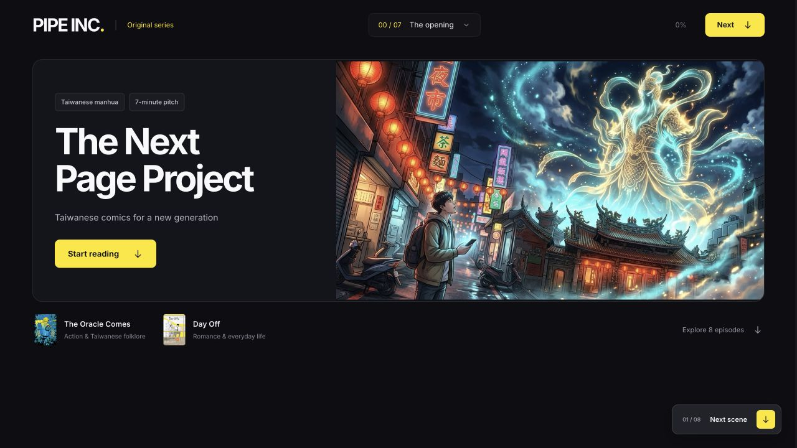
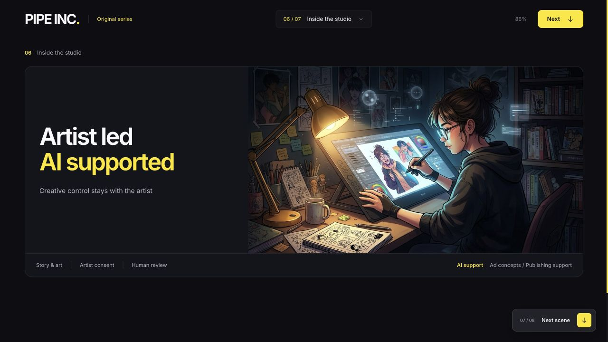

# PIPE INC. — The Next Page Project

An interactive browser presentation that introduces Taiwanese comics through eight chapters, illustrated storytelling, and short reader polls.

**Private portfolio archive.** Jeremy authorized a private source upload. Public distribution of the included illustrations, official comic covers, and screenshots has not been cleared; attribution does not grant those rights.



*Authentic screenshot from the existing project delivery, included for private portfolio review.*

## Overview

The Next Page Project turns a presentation about Taiwanese comics into a guided web experience. Readers move through an agency introduction, comics history, two title spotlights, an artist-led studio concept, and a closing response prompt. It is a static presentation with browser interactions; it is not a publishing service or an AI model application.

## Features

- Eight chapters with a chapter picker, next-scene controls, and reading progress.
- Keyboard navigation with Arrow Down, Page Down, Space, and Arrow Up.
- Spotlights for **The Oracle Comes** and **Day Off**, linking to their source pages.
- Reader polls saved on the current browser using `localStorage`, with an in-memory fallback when storage is unavailable.
- Responsive layouts, native dialogs, visible keyboard focus, a skip link, alternative image text, and reduced-motion styles.
- A self-contained HTML export with embedded artwork and font data.



## Technology

| Layer | Implementation |
| --- | --- |
| Structure and interface | Semantic HTML and CSS in `template.html` |
| Browser behavior | Plain JavaScript, DOM events, IntersectionObserver, native dialogs |
| Reader response storage | Browser `localStorage`; no server or shared poll results |
| Build | Python 3 standard library: `pathlib`, `base64`, and `json` |
| Visual assets | Six WebP images, embedded SVG icons, locally bundled Inter font |
| Hosting | Static files; no database, application server, or package install required |

## Architecture

```text
template.html            HTML, CSS, chapter content, and browser interactions
build.py                 Embeds artwork, the font, and its license into the template
assets/                  WebP artwork and Inter font assets
  inter-OFL.txt          Bundled font license
  comic-sources.json     Third-party comic source and credit information
dist/index.html          Generated, self-contained presentation
docs/images/             Portfolio screenshots
ASSET_NOTICES.md         Publication review notes and asset attribution
```

The build replaces an artwork manifest placeholder and font marker. At runtime, JavaScript assigns embedded images, builds the chapter menu, updates progress, and manages reader selections. All responses stay in the reader's browser. There are no analytics or network API calls in the reviewed application code; external source links open only when followed.

## Run locally

With Python 3 installed, from the project folder:

```sh
mkdir -p dist
python3 build.py
python3 -m http.server 8000 --directory dist
```

Open `http://localhost:8000`. The generated HTML also contains its own font and images, but a local server gives browser storage a consistent origin.

No Node.js, npm, React, or backend setup is needed. The current self-contained export is approximately 7.25 MB because it embeds the artwork. Editing the template requires rebuilding the export.

## My role and AI-assisted development

Jeremy Budianto provided the project idea and product direction, learning from and drawing inspiration from websites to decide what to build. He used **Codex** to develop the application; Codex generated and revised the implementation. This portfolio describes Jeremy’s work in concept and design direction without claiming that he manually wrote the underlying architecture or independently implemented and tested every feature.

The code was inspected during portfolio preparation. AI assistance is part of the development process; the application does not call an AI model at runtime. Any additional research, content, testing, and team contributions need confirmation before publication.

The four main illustrations are recorded in source metadata as user-supplied. Their creation method and publication rights need confirmation. The official comic covers are third-party works and are not Jeremy's original artwork.

## Verification and limitations

Portfolio preparation on 29 October 2026 verified that:

- Rebuilding an isolated copy with Python reproduces the current HTML export byte for byte.
- Both inline JavaScript blocks pass Node's syntax check.
- The generated export matches the previously delivered single-file project.
- The screenshots above are authentic existing project screenshots and were visually reviewed.

These checks do not certify accessibility, cross-browser behavior, or production readiness. Current browser interaction testing was not completed in this review environment. Poll results are personal selections, not aggregated audience measurements. The historical content and any business or audience claims need editorial verification before wider use.

## Publication recommendation

**Keep this repository private.** The private archive includes the editable source and its six artwork assets. Local clipboard-path metadata, hosting settings, original Git history, and the rebuildable HTML export are omitted from the prepared source. Public distribution needs cleared or replacement artwork, approved screenshots, and a fresh content review.

No open-source license has been selected. See [asset review notes](ASSET_NOTICES.md) before distributing the application, its embedded export, or its screenshots.
